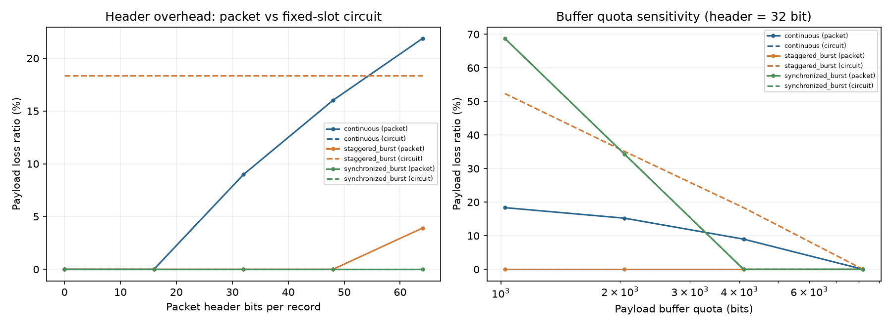

# 实验一报告

姓名：刘高荣  学号：2024221283  GitHub：SZU-LLL  提交编号：见教师仓库 PR 最新 commit

## 实验目的
比较固定时隙电路交换与共享FIFO分组交换在同一条链路上的资源使用差异，理解统计复用收益与包头开销的权衡，掌握有效载荷利用率、线路忙碌率、完成时延、丢失率与积压等指标的含义和关系。

## 原理和模型
- **电路交换**：固定时隙预留，tick % users决定当前服务用户，其他用户不能借用空闲时隙，即使空闲也浪费。
- **分组交换**：所有用户共享一个FIFO队列，每条记录带32bit包头，可跨tick续传，统计复用让空闲时隙被其他用户利用。
- **缓存准入**：已预留payload加新记录超过4096bit时整条尾丢弃；包头只占线路容量，不占payload缓存。
- **观察窗口**：[0,256) tick，窗口结束立即停止，未完成记录计积压，不追加排空时间。
- 本模型是单链路抽象，与真实PCM（32时隙×8bit×8000帧/s=2.048Mbit/s）不同，不模拟传播、误码、重传。
- **公平比较的固定条件**：同一场景下两模型吃同一份`Arrival`序列，容量128bit/tick、缓存4096bit payload、观察窗256tick、事件顺序（先准入后发送）全部相同；唯一差别是电路按`tick%users`独占时隙、分组共享FIFO且每条记录多32bit包头。任何参数实验都只改一个变量并单独存放，不混进基线8组结果。

## 手工推演
2用户、2 tick、每tick 128bit容量，包头32bit，缓存足够。tick 0时用户1到达一条96bit记录。
- **电路交换**：tick 0服务user0（空闲，发0bit）；tick 1服务user1，发96bit，在2ms完成。有效利用率=96/256=37.5%，线路忙碌率=96/256=37.5%。
- **分组交换**：tick 0到达即入队，wire=96+32=128bit，一个tick发完，1ms完成。有效利用率=96/256=37.5%，线路忙碌率=128/256=50%。
结论：相同有效利用率下，分组交换时延更低（1ms vs 2ms），但线路忙碌率更高（包头开销）。

再手算一次带缓存的准入（对应用例AC07）：缓存100bit，同一tick先到80bit、后到40bit，且本tick该用户没有发送机会。到达80时"0+80≤100"成立，准入；到达40时"80+40>100"，整条尾丢弃，不做部分入队。于是这一tick的记账是生成120、交付0、丢弃40、积压80，120=0+40+80，守恒成立。若把丢弃写成60或把积压算成40，summarize会直接抛ValueError——这也是我不让实现"尽量塞进去"的原因。

## 实验结果

| 场景 | 模式 | 有效利用率 | 线路忙碌率 | 平均时延(ms) | 最大时延(ms) | 丢失率 | 积压(bit) |
|---|---|---|---|---|---|---|---|
| continuous | circuit | 100% | 100% | 2.5 | 4.0 | 0 | 0 |
| continuous | packet | 79.7% | 100% | 26.1 | 40.0 | 9.0% | 3712 |
| staggered_burst | circuit | 49.2% | 49.5% | 45.1 | 127.0 | 18.4% | 3936 |
| staggered_burst | packet | 75.0% | 100% | 1.0 | 1.0 | 0 | 0 |
| synchronized_burst | circuit | 34.0% | 34.4% | 12.7 | 24.0 | 0 | 1152 |
| synchronized_burst | packet | 32.8% | 43.8% | 15.4 | 32.0 | 0 | 1536 |
| light_random | circuit | 21.1% | 21.1% | 3.1 | 10.0 | 0 | 0 |
| light_random | packet | 21.1% | 28.1% | 1.1 | 2.0 | 0 | 0 |


**利用率和时延指向不同结论的例子**：在continuous满载场景，电路交换有效利用率100%、平均时延仅2.5ms，看似优于分组交换的79.7%/26.1ms。但这是因为所有用户每4tick同时发128bit，电路交换的固定时隙恰好匹配这种周期性负载；分组交换因为包头占用线路容量，在连续满载时反而因队列积压导致丢失和时延。反过来在staggered_burst突发热点场景，电路交换有效利用率仅49.2%、丢失率18.4%，而分组交换75%利用率、零丢失——这就是统计复用的优势。

另外两个场景的读法不一样：

- **synchronized_burst（每80tick集中32条）**：电路有效利用率34.0%、平均时延12.7ms、积压1152bit；分组32.8%、15.4ms、1536bit，两者丢失率都是0。分组把线路忙碌率从34.4%拉到43.8%，却比电路多等2.7ms、多积压384bit——因为分组把32条记录排进同一条FIFO严格串行，而电路是4条独立队列各自只等自己的时隙，能借用空闲时隙不等于总能更快。
- **light_random（轻载8%）**：两模型有效利用率都是21.1%、积压都为0；分组线路忙碌率28.1%（多出的7%全是包头），但时延1.1ms对3.1ms。轻载下统计复用的收益体现在时延，而不是利用率。

**数据自洽性**：8组结果都满足generated = delivered + dropped + backlog，summarize每次运行都会校验，不成立就抛ValueError；comparison.json里8组trace的原始计数也逐一核对过，上表数值由comparison.csv四舍五入得到，没有手工改数。

## 自拟反例
在student_tests/test_my_case.py中写了3个测试：
1. **test_partial_send_not_completed_circuit**：200bit记录、128bit容量，第一个tick发128bit后记录剩余72bit，断言sent=128、completed为空、记录仍在队列。揭示"部分发送不能误记为完成"的错误。
2. **test_partial_send_not_completed_packet**：96bit payload+32bit头=128bit wire，一个tick刚好发完，断言completed=1。验证包头只计一次、不重复加。
3. **test_circuit_does_not_steal_slots**：tick=0服务user0（空），user1有数据，断言sent=0、user1记录仍在。揭示电路交换不能错误借用时隙。

## 参数变化分析

在基线配置（4用户、256 tick、128 bit/tick、tick_ms=1）之上每次只改一个参数，其余保持基线；由 `analysis/param_sweep.py` 生成，完整 72 行长表在 `results/extra/parameter_sweep.csv` 与 `parameter_sweep.json`。这是附加实验，基线那 8 组结果未被替换。

### 1. 包头大小（header_bits = 0/16/32/48/64）

| 场景 | 指标 | 0 bit | 16 bit | 32 bit | 48 bit | 64 bit |
|---|---|---|---|---|---|---|
| continuous | packet 有效利用率 | 100% | 88.7% | 79.7% | 72.7% | 66.4% |
| continuous | packet 丢失率 | 0 | 0 | 9.0% | 16.0% | 21.9% |
| staggered_burst | packet 有效利用率 | 75.0% | 75.0% | 75.0% | 66.5% | 59.8% |
| staggered_burst | circuit 有效利用率 | 49.2% | 49.2% | 49.2% | 49.2% | 49.2% |

电路交换那一行在所有包头取值下都是 49.2%，因为它根本不发包头——这条水平线正好充当控制变量的对照，说明其余变化确实来自包头而非别的因素。分组交换的有效利用率随包头线性下降；只有在 continuous 这种每个 tick 都满载的业务里，包头开销才立刻变成真实丢弃（0→21.9%）。staggered_burst 在 0/16/32 三档都保持 75% 且零丢失，说明平均负载留有余量时 32 bit 包头是可承受的；到 48 bit 余量被吃光，才出现积压（2784 bit）和时延上升。

### 2. 缓存配额（buffer_payload_bits = 1024/2048/4096/8192，包头固定 32 bit）

| 场景 | 指标 | 1024 | 2048 | 4096 | 8192 |
|---|---|---|---|---|---|
| continuous | packet 丢失率 | 18.4% | 15.2% | 9.0% | 0 |
| continuous | packet 平均时延 | 8.2 ms | 16.1 ms | 26.1 ms | 28.5 ms |
| continuous | packet 积压 | 640 | 1664 | 3712 | 6656 |
| synchronized_burst | circuit 丢失率 | 68.8% | 34.4% | 0 | 0 |
| synchronized_burst | packet 丢失率 | 68.8% | 34.4% | 0 | 0 |

缓存从 1024 加到 8192，continuous 的丢失率从 18.4% 降到 0，代价是平均时延从 8.2 ms 涨到 28.5 ms、积压从 640 bit 涨到 6656 bit：缓存只是把"丢弃"换成了"更长的排队"。本模型窗口结束立即停止、不追加排空，所以丢包率下降不等于系统变好。synchronized_burst 的两种模型在 1024/2048 下丢失率完全相同（68.8%/34.4%），说明集中突发时决定成败的是缓存总量而不是交换方式本身。



## 分析与限制
- **缓存不是越大越好**：如上表，扩大缓存能消掉丢失，但把代价转移到时延和积压上；评价必须同时看这三个量。
- **统计复用优势**：staggered_burst下分组把电路浪费的空闲时隙用起来，有效利用率75.0%对49.2%且零丢失；轻载的light_random两模型利用率相同（21.1%），收益体现在时延1.1ms对3.1ms。
- **满载时分组未必更好**：continuous场景下所有用户同时发，固定时隙恰好匹配周期负载；分组交换每条记录额外32bit包头，连续满载时队列积压导致丢失。
- **未完成≠丢包**：积压是窗口结束时还在传的数据，不是丢了；丢失率只统计缓存满时被尾丢弃的记录。
- **不能只看平均时延**：如果只有少量记录完成而大量积压或丢失，平均时延可能很低但系统实际性能差，必须同时看交付量、丢失和积压。
- **模型简化**：单链路、无传播/误码/重传/多跳，缓存只按payload计（包头不占缓存），窗口结束不排空。这些约定让比较公平但也让积压偏大，结论只适用于本抽象，不能直接外推成"互联网整体优劣"。

## AI使用说明
用AI辅助生成3个函数的初始实现，核心循环是"读模型约定→写函数→跑测试→根据失败断言修正"。验证决策：先按docstring写最小实现，再用教师给的4+4+3项测试验证，不修改测试来迁就实现。参数变化分析、四场景解读、复现说明等章节的初稿与数据核对也由AI助手协助完成，报告里每个数字都能在`results/comparison.csv`或`results/extra/parameter_sweep.csv`里查到。详细见AI_LOG.md。

## 复现说明
- **环境**：Python 3.13.1（仓库内`.venv`），依赖见`requirements.txt`（numpy、matplotlib、pytest），不需要联网或额外仿真软件。
- **命令**（仓库根目录，PowerShell，逐行执行）：
  ```powershell
  .\.venv\Scripts\python.exe -m pytest grading student_tests -q
  .\.venv\Scripts\python.exe src/performance_test.py
  .\.venv\Scripts\python.exe analysis/param_sweep.py
  .\.venv\Scripts\python.exe grading/calculate_grade.py
  ```
- **预期结果**：测试26项全部通过；`results/`生成`comparison.json`（8行rows + 8组traces）、`comparison.csv`（8行）、3张PNG；`results/extra/`生成72行长表与`param_sweep.png`；自动分70/100（另有30分人工复核）。
- **可复现性**：随机业务固定`seed=2026`，同一参数连续运行两次，`comparison.csv`与`parameter_sweep.csv`的SHA256完全一致。
- **提交注意**：`results/*`被`.gitignore`忽略，结果文件需`git add -f`单独添加，否则GitHub上看不到图。

## 参考资料
- 课堂PRD文档：实验一_PRD_电路交换与分组交换.docx
- 教师仓库：https://github.com/jwentong/modern-switching-experiment-01
